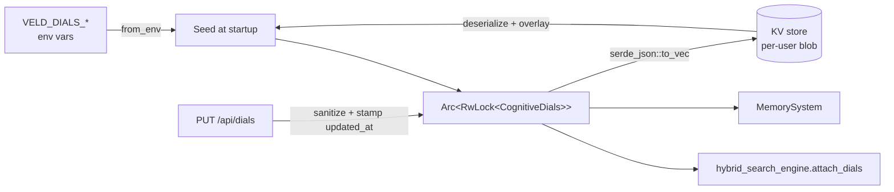

# Cognitive Dials

`CognitiveDials` is the unified, runtime-tunable surface for veld's cognitive
system. One place to toggle or tune the parameters a human (via the monitor's
"Dials" tab) or Spine (via the automated-tuning path) can drive at runtime —
rather than a second tuning system beside
[`FeedbackStore`](../reference/http-api.md)'s learned weights and the
Spine-pushed [`ExternalDimensionScores`](knowledge-graph.md#external-dimension-scores).

Source: [src/memory/dials.rs](https://github.com/Portll/veld/blob/main/src/memory/dials.rs).

## Two groups of dials

| Group | Touches | Where it runs |
|---|---|---|
| **Reconsolidation (plasticity)** | The FIX-R1 labile-window close and the composable re-encode layers | `run_maintenance` — background, off the synchronous recall hot path |
| **Retrieval (fast ↔ accurate)** | Optional overrides for the hybrid-search knobs (cross-encoder budget, RRF k, refiner mode, etc.) | The recall hot path itself, when set |

`Default` is everything OFF / `None`. A freshly-seeded `CognitiveDials`
changes nothing — every retrieval dial is `None` so the engine uses its
learned-weight default; every plasticity dial is `false`/zero so
reconsolidation behaves exactly as it did pre-dials.

## Lifecycle



1. **Seed from env** — `CognitiveDials::from_env()` reads `VELD_DIALS_*`
   variables once at startup.
2. **Overlay from KV** — if the user has a persisted blob at
   `COGNITIVE_DIALS_KEY`, deserialize and `sanitized()`-overlay it. A corrupt
   blob is logged and skipped (not fatal).
3. **Attach** — the `Arc<RwLock<CognitiveDials>>` is handed to the hybrid
   search engine and stored on `MemorySystem`. The engine's recall path
   reads through this handle on every call, so a runtime change takes
   effect immediately.
4. **Persist** — `PUT /api/dials` replaces the in-memory state, calls
   `sanitized()` to clamp values into legal ranges, stamps `updated_at`,
   and writes the JSON blob back to the KV store.

## REST surface

Two routes on the **protected** router (per-user, X-API-Key required):

```
GET /api/dials?user_id=…   → CognitiveDials JSON
PUT /api/dials             → replace with the body's CognitiveDials JSON
```

Full-replace REST semantics — the client GETs, edits, and PUTs the whole
struct. There is no PATCH; partial updates would race against
Spine-driven updates on the same key.

Source: [src/handlers/dials.rs](https://github.com/Portll/veld/blob/main/src/handlers/dials.rs).

## TUI surface

The Veld Monitor exposes a **"Dials" tab** (see
[tui/src/tabs/dials.rs](https://github.com/Portll/veld/blob/main/tui/src/tabs/dials.rs))
that GETs the current dials, renders each value as a tunable widget, and
PUTs on commit. Real-time visibility on what's currently set + an easy way
to undo experiments.

## Reranker dials

Five retrieval dials drive the Layer 5.3 cross-encoder
([retrieval.md](retrieval.md#cross-encoder-reranking)):

| Dial | Type | `None` means | Env seed |
|---|---|---|---|
| `use_reranking` | `Option<bool>` | the layer runs | `VELD_DIALS_USE_RERANKING` |
| `rerank_count` | `Option<usize>`, clamped to 1..=200 | at most 20 candidates (30 for a decomposed query), and never more than twice `max_results`; a set value is the budget itself | `VELD_DIALS_RERANK_COUNT` |
| `rerank_pool` | `Option<usize>`, clamped to 10..=500 | Layer 4 keeps 30 fused candidates (50 for a decomposed query) for the layer; never fewer than `rerank_count` | `VELD_DIALS_RERANK_POOL` |
| `ce_blend` | `Option<f32>`, clamped to 0..=1 | the cross-encoder carries 18% of the blended score (45% for a decomposed query, which never takes less) | `VELD_TUNE_CE_BLEND` |
| `rerank_model` | `Option<String>`, a registry id | the process-wide model: `VELD_CROSS_ENCODER`, else `mxbai-rerank-xsmall-v1` | `VELD_DIALS_RERANK_MODEL` |

Depth takes all three of `rerank_pool`, `rerank_count` and `ce_blend`. On the LoCoMo
gate a quarter of all gold sits between rank 11 and rank 100. A larger `rerank_count`
cannot reach gold that Layer 4 already cut, and at an 18% blend the cross-encoder moves
a candidate a few places, not from rank 40 into the top ten. Each candidate in the
budget is one cross-encoder forward pass, so latency grows with `rerank_count`.

`rerank_model` is applied when the dials are loaded at startup and on every
`PUT /api/dials`: the user's `CrossEncoderReranker` switches to the named
model, keeps every model it has selected before loaded, and pre-fetches a new
one in the background. `sanitized()` drops an id the registry does not know, and
a model that cannot be built clears the dial before it is stored, so
`GET /api/dials` never names a model that is not reranking. Both dials default to
`None`: the shipped pipeline is unchanged until someone turns them.

The recall gate records the model, cap, pool and blend it measured under
(`RerankSetting` in `src/recall_harness/report.rs`) and refuses to gate across
them. `recall.yml` takes `rerank_model`, `rerank_count`, `rerank_pool` and
`ce_blend` as dispatch inputs for a comparison run (`record=true`). The baseline
is `mxbai-rerank-xsmall-v1` at cap 20 with the shipped pool and blend, and the
parity arm against upstream shodh-memory is `ms-marco-MiniLM-L-6-v2` at cap 30.

Selectable models (`src/embeddings/cross_encoder.rs`). Two are pinned to a
revision and verified by SHA-256 before they load; the rest follow their
repository's `main` branch and should be pinned before they are relied on for a
measurement.

| Registry id | Params | Licence | Pinned |
|---|---|---|---|
| `mxbai-rerank-xsmall-v1` (default) | 70 M | Apache-2.0 | `b5c6e9da` |
| `ms-marco-MiniLM-L-6-v2` (parity arm) | 22 M | Apache-2.0 | `233902d2` |
| `mxbai-rerank-base-v1` | 184 M | Apache-2.0 | no |
| `mxbai-rerank-large-v1` | 435 M | Apache-2.0 | no |
| `jina-reranker-v1-tiny-en` | 33 M | Apache-2.0 | no |
| `jina-reranker-v1-turbo-en` | 37 M | Apache-2.0 | no |
| `bge-reranker-v2-m3` (hooman650 ONNX export) | 568 M | Apache-2.0 | no |
| `jina-reranker-v2-base-multilingual` | 278 M | CC-BY-NC-4.0 (non-commercial; never a default) | no |

Each entry's licence is the `license` field of its `CrossEncoderConfig`, as the
model card declared it at the revision recorded here.

## Forward-compatible serialisation

Every field in `CognitiveDials` carries `#[serde(default)]` so older
persisted blobs decode forward-compatibly when new dials land. The
sanitisation pass clamps each retrieval dial to its valid range
(`None` is always valid) before the value reaches the engine — a corrupt
or out-of-range write cannot destabilise retrieval.

## Why dials, not just config

`ServerConfig` and the `VELD_*` env vars are *startup-time* knobs. Dials are
the *runtime* surface for things that benefit from being tweaked while the
server is live:

- Quick A/B sweeps without a restart.
- Spine-driven automated tuning that wants to push a new RRF k or
  cross-encoder budget every few minutes based on quality signals.
- Per-user overrides — every user's dials are independent.

The boundary is: structural choices (storage backend, embedder URL, bind
address) stay in config; behavioural-tuning choices (rerank budget, decay
factor, refiner mode) live in dials.

## See also

- [Retrieval pipeline](retrieval.md) — the 20-signal pipeline whose
  cross-encoder / RRF / refiner knobs the retrieval dials override.
- [Consolidation](consolidation.md) — the plasticity dials gate the
  reconsolidation paths that run inside `run_maintenance`.
- [Instance registry](instance-registry.md) — sibling subsystem that the
  monitor's other tabs read from.
