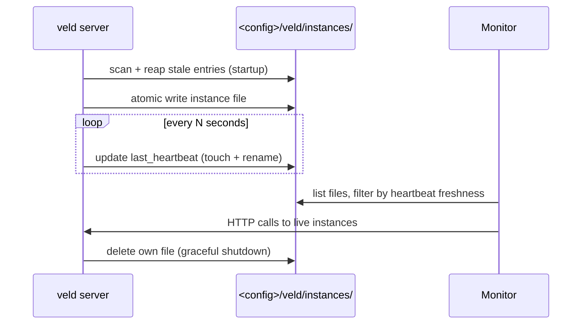

# Instance registry

The instance registry is how a running `veld server` makes itself
discoverable. Rather than have clients *guess* which ports a veld might be
listening on, each server **declares itself**: after a successful port bind
it atomically writes a small JSON file to a shared directory, heartbeats it
periodically, and removes it on graceful shutdown. Consumers (the Veld
Monitor via `status-core`, the Claude statusline) read that directory to
learn the live fleet — no port lists, no probing.

Source: [src/instance_registry.rs](https://github.com/Portll/veld/blob/main/src/instance_registry.rs).

## Why the filesystem

- Zero external dependency.
- Cross-platform (Linux/macOS/Windows all have a config dir).
- Works fully offline.
- Needs no broker or daemon.
- Matches veld's "single binary, no external services" ethos.

The registry lives under the **config** dir (`<config>/veld/instances/`),
which is shared across instances even when each runs with a different
`VELD_MEMORY_PATH`. This is deliberate: multiple veld instances with
isolated data still share a fleet view.

## Per-instance file shape

Each instance writes one JSON file named `<instance_id>.json` containing:

| Field | Purpose |
|---|---|
| `instance_id` | UUID generated at startup |
| `pid` | Process id (informational; not used for liveness) |
| `bind_host` / `bind_port` | Where the HTTP API is listening |
| `started_at` | ISO 8601 timestamp |
| `last_heartbeat` | Updated by the heartbeat task |
| `version` | The veld version string |
| `feature_flags` | Optional list of compile-time features for filtering |
| `launch` | Optional: `exe`, `args`, `cwd` and the *names* of the `VELD_*` variables the server started with. Lets the Veld Monitor's "Restart server" relaunch it the same way; values are never written |

Writes are atomic (`write-to-tempfile + rename`) so a reader never sees a
half-written entry.

## Liveness without pid-probing

Cross-platform "is pid N alive?" is awkward (no portable syscall, requires
permissions on some hosts). The registry sidesteps this entirely: liveness
is decided purely by heartbeat freshness.

```
live iff (now - last_heartbeat) < STALE_TTL
```

- Each running server heartbeats its own file every few seconds.
- Servers reap stale entries (older than `STALE_TTL`) on startup.
- **Readers never delete** — this avoids reader-vs-reader races and
  reader-vs-writer races. The cleanest contract is: only writers write,
  only writers (during their own startup) clean.

## Discovery interface — `InstanceDiscovery`

`InstanceDiscovery` abstracts "list the live fleet" so consumers don't
hard-code the filesystem path.

```rust
trait InstanceDiscovery {
    fn list_live(&self) -> Vec<InstanceRecord>;
}
```

Two implementations:

| Implementation | Available | Source |
|---|---|---|
| `FilesystemDiscovery` | today | Default — scans `<config>/veld/instances/` |
| `ZenohDiscovery` / mDNS provider | future | Behind a feature flag; merges fleet from a Zenoh network or LAN mDNS announcements |

Adding a network discovery provider doesn't change consumer code — they
keep calling `.list_live()` on whichever provider was injected.

## Consumers

| Consumer | What it does with the registry |
|---|---|
| Veld Monitor | Renders the fleet in its dashboard — each instance with version, bind address, dial overrides, and the server's uptime from `started_at` beside the time the monitor has watched it |
| Claude statusline (`hooks/statusline.ts`) | Picks the local instance to talk to without the user setting `VELD_API_URL` |
| `veld tui` | Connects to the discovered instance instead of hard-coding `127.0.0.1:3030` |

## Lifecycle



## See also

- [Storage](storage.md) — the in-tree storage that each instance manages
  privately, even when the registry view is shared.
- [Cognitive dials](dials.md) — what the monitor displays per discovered
  instance.
- [Deploying](../guides/deploying.md) — how multiple instances are typically
  arranged on a host.
