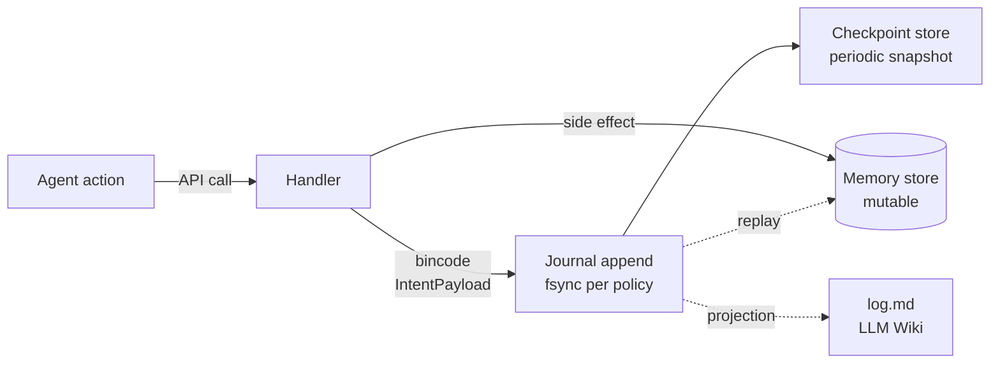

# Intent log

The intent log is veld's event-sourced journal of agent actions. Every
agent operation — `remember`, `recall`, `reinforce`, `anchor`, `tier_move`,
`forget` — emits a typed `IntentPayload` event, bincode-encoded and
appended to the log.

The arrows from journal to memory store and wiki are *projections* — the
log is canonical; everything else is derived state that can be rebuilt.

Implementation: [`src/intent_log/`](https://github.com/Portll/veld/tree/main/src/intent_log).

| File | Role |
|---|---|
| `mod.rs` | Public API; `IntentLog` type; segment rotation and reads across segments |
| `header.rs` | Log file header with version, base LSN and checksum |
| `journal.rs` | Journaled writer: append, fsync, apply to projections |
| `payload.rs` | Typed `IntentPayload` enum with bincode codec |
| `projection.rs` | Project events back into memory state (replay) |
| `checkpoint_store.rs` | Periodic snapshot of derived state for fast replay |
| `migrations.rs` | Schema-version migration for old log files |

## Why event-sourced?

The memory store is mutable — memories grow more important, decay, get
forgotten. The intent log is the **single ground truth** for what an agent
actually *did*, independent of what the memory store currently shows.

This matters for:

- **Audit:** "did the agent ever access memory X?" — grep the intent log.
- **Replay:** "rebuild the memory store from scratch as of timestamp T"
  — replay the intent log up to that point.
- **Drift detection:** if the memory store and intent log diverge, something
  silently corrupted the store. The log wins.
- **Time-coherent projection (LLM-Wiki):** the wiki's `log.md` is a direct
  projection of the intent log. Time-coherence between veld and the wiki
  is built-in because the log is the canonical timeline.

## Segments

A tenant's journal is `intent.log` (the head) plus the segments it has sealed,
`intent.log.seg.<first LSN, 20 digits>`. When a sync leaves the head at
`VELD_INTENT_LOG_SEGMENT_MB` (config.toml `intent_log_segment_mb`, default 256;
0 never rotates), the head is renamed to a segment and a new head starts. The
new head's header names the LSN its first frame carries and keeps the log's
creation time, which replication followers use to tell a log from its
replacement. Rotation runs only at a sync point, so no frame spans two files.

Readers go through the segments in LSN order and refuse a gap between them.
Sealed segments are never written again: a backup hard-links them into the
archive and caches each one's digest and LSN range beside it
(`<segment>.backup.json`), so capturing the journal, which holds the tenant's
journal lock, costs a copy of the head rather than of the whole log. A restore
puts back the archive's segments and removes the live ones sealed after the
backup. A point-in-time restore into a sealed segment copies it before cutting
it, so the archive's link keeps every frame.

A log that has rotated needs a build that reads segments. Nothing removes old
segments yet: the log's total size still grows with every write.

## Payload shape

`IntentPayload` is the canonical typed enum (see
[`src/intent_log/payload.rs`](https://github.com/Portll/veld/blob/main/src/intent_log/payload.rs)).
Bincode encoding gives us compact serialization with schema-version checks on
read. Bincode is positional (a variant index, then the fields in order), so the
payload grows only by appending variants: a field added to an existing variant
makes every older frame of it undecodable, whatever `#[serde(default)]` says. A
binary that predates a variant cannot decode frames carrying it, so followers
are upgraded before their leader. Anchoring is journaled as `SetAnchored`
(flag and importance); `Anchor` (importance only) remains for older logs.

Recent work (commit `3173a16`) made the payload fully typed — previously it
was a JSON blob. The transition is part of the v0.8 stabilization.

## See also

- [Consolidation](consolidation.md) — also emits events to the log
- [Decision 0002](../decisions/0002-llm-wiki-dual-pathway.md) — how the log
  underwrites wiki time-coherence
